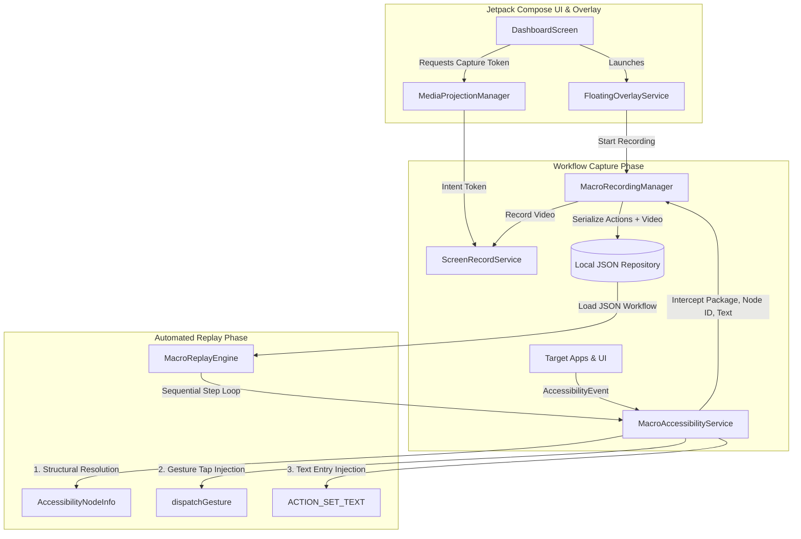

# Native Android Kotlin Macro Recorder & Replayer

A deterministic, non-AI Native Android application that records and programmatically replays user workflows across target third-party applications.

---

## 🏗 Architecture & Key Components

The app implements five core components:



### 1. Background `AccessibilityService` (`MacroAccessibilityService`)
* **Screen Interaction Interception**: Listens to system-wide accessibility events (`TYPE_VIEW_CLICKED`, `TYPE_VIEW_TEXT_CHANGED`, `TYPE_VIEW_SCROLLED`).
* **Structural Reliability (Non-AI)**: Rather than brittle, screen-resolution-dependent raw X/Y points, it extracts:
  * Active target app package name (`event.packageName`)
  * Specific Android Resource Node ID (`node.viewIdResourceName`, e.g. `com.android.settings:id/search_action_bar`)
  * Text label and content description (`node.text` / `node.contentDescription`)
  * Step timing delay relative to previous action
  * Fallback bounds (`Rect`) for gesture coordinate calculation when necessary.
* Configured in `res/xml/macro_accessibility_service_config.xml` with:
  * `canRetrieveWindowContent="true"`
  * `canPerformGestures="true"`

### 2. MediaProjection Screen Recording (`ScreenRecordService`)
* **Simultaneous Video Capture**: Records high-definition `.mp4` video (H.264 / AAC) of the device screen while the workflow is captured.
* **Android 14+ Foreground Service**: Runs with `FOREGROUND_SERVICE_TYPE_MEDIA_PROJECTION` and an ongoing foreground notification.
* Automatically creates a `VirtualDisplay` backed by a `MediaRecorder` surface to stream screen frames directly to internal storage.

### 3. Serialization to Local JSON (`MacroWorkflow` & `MacroAction`)
Workflows are serialized into human-readable, deterministic JSON specifications stored at `context.filesDir/macros/macro_<id>.json`:

```json
{
  "id": "c7a86f91-d820-4b2a-8fbb-7c1c2ef38901",
  "name": "Android Settings Display Flow",
  "createdAt": 1729938000000,
  "durationMs": 5700,
  "videoFilePath": "/data/user/0/com.macrorecorder.app/files/recordings/recording_c7a86f91.mp4",
  "actions": [
    {
      "stepIndex": 1,
      "actionType": "CLICK",
      "packageName": "com.android.settings",
      "resourceId": "com.android.settings:id/search_action_bar",
      "textLabel": "Search settings",
      "contentDescription": "Search settings",
      "className": "android.widget.TextView",
      "textPayload": null,
      "delayFromPreviousMs": 800,
      "timestamp": 1729938000800,
      "fallbackBounds": {
        "left": 48,
        "top": 120,
        "right": 1032,
        "bottom": 230
      }
    },
    {
      "stepIndex": 2,
      "actionType": "SET_TEXT",
      "packageName": "com.android.settings",
      "resourceId": "android:id/search_src_text",
      "textLabel": null,
      "contentDescription": null,
      "className": "android.widget.EditText",
      "textPayload": "Display & brightness",
      "delayFromPreviousMs": 1200,
      "timestamp": 1729938002000,
      "fallbackBounds": {
        "left": 120,
        "top": 120,
        "right": 960,
        "bottom": 230
      }
    }
  ]
}
```

### 4. Sequential Replay Engine (`MacroReplayEngine`)
* Coordinates replay step-by-step using Kotlin Coroutines:
  * **Timing**: Respects recorded `delayFromPreviousMs`.
  * **Target App Focus**: Brings the target package to the foreground if needed.
  * **Structural Resolution**: Queries the active window tree using `findAccessibilityNodeInfosByViewId` and `findAccessibilityNodeInfosByText`, with a recursive DFS tree traversal fallback.
  * **Action Injection**:
    * **Clicks**: Calls `dispatchGesture()` with a `GestureDescription` stroke at the resolved node's center, plus `node.performAction(ACTION_CLICK)`.
    * **Text Input**: Calls `node.performAction(AccessibilityNodeInfo.ACTION_SET_TEXT, bundle)` with `ACTION_ARGUMENT_SET_TEXT_CHARSEQUENCE`.
    * **Scrolls & Navigation**: Performs `ACTION_SCROLL_FORWARD` or `GLOBAL_ACTION_BACK`.

### 5. Jetpack Compose UI Dashboard & Floating Trigger Overlay
* **Material 3 Compose Dashboard (`MainActivity`)**:
  * Real-time readiness cards for Accessibility Service, Overlay permission (`SYSTEM_ALERT_WINDOW`), and MediaProjection capture.
  * List of saved workflows with step count, duration, package badges, and action buttons:
    * **Replay**: Triggers live sequential injection.
    * **Inspect JSON**: Full modal displaying formatted JSON with 1-click clipboard copy.
    * **Preview Video**: Embedded video player to watch the recorded screen video.
    * **Delete**: Removes JSON and video file.
* **Floating Trigger Overlay (`FloatingOverlayService`)**:
  * Draggable pill overlay that floats over any third-party app.
  * Provides quick **Record**, **Stop**, and **Replay** controls with a real-time status badge (`IDLE`, `REC (N)`, `STEP X/Y`).

---

## 🚀 Building & Running the Project

### Requirements
* Android Studio Iguana / Jellyfish / Koala (or newer)
* JDK 17
* Android SDK 34 (minSdk 26, targetSdk 34)

### Opening in Android Studio
1. Open Android Studio.
2. Select **Open** and select the directory:
   ```
   C:\Users\ashut\OneDrive\Documents\macro-recorder-app
   ```
3. Let Gradle sync project dependencies.

### Command Line Build
To build the debug APK:
```bash
./gradlew assembleDebug
```
On Windows PowerShell:
```powershell
.\gradlew.bat assembleDebug
```

---

## 📱 How to Use

1. **Launch App**: Open **Macro Recorder**.
2. **Grant Permissions**:
   * Tap **Enable Service** next to Accessibility Service and toggle on *Macro Recorder Automation Service*.
   * Tap **Grant Overlay** to enable *Draw over other apps*.
   * Tap **Grant Capture** to authorize MediaProjection screen capture.
3. **Record a Workflow**:
   * Tap **Start Recording Macro** in the dashboard, or toggle on the **Floating Overlay** and tap the red record circle over any target app (e.g. Settings, Calculator).
   * Perform your actions. Every click, node ID, and text input will be logged structurally, and video will be recorded.
   * Tap **Stop & Save**.
4. **Replay**:
   * Tap **Replay** on the macro card in the dashboard or the play button on the floating overlay.
   * The app will sequentially execute gestures and text inputs automatically.
5. **Inspect JSON / Watch Video**:
   * Tap **JSON** to view and copy the raw structural JSON.
   * Tap **Video** to watch the synchronized screen recording.
